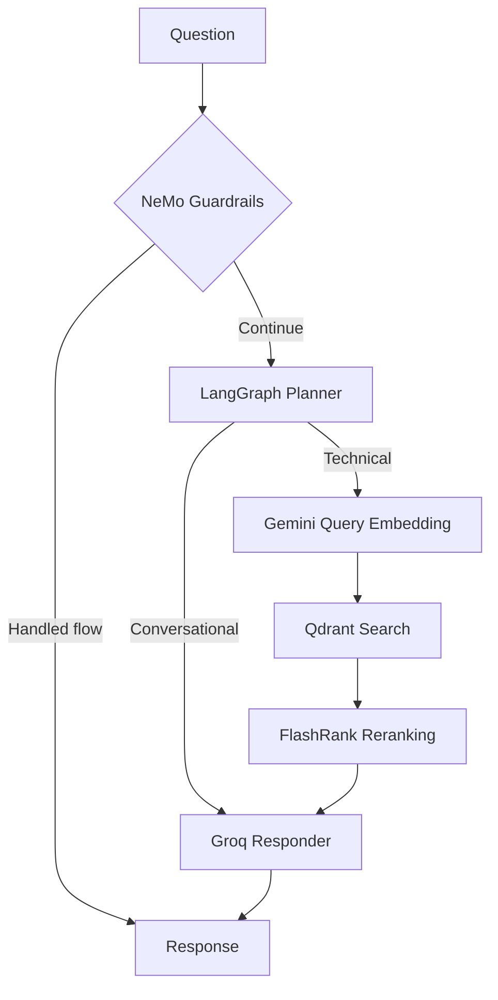
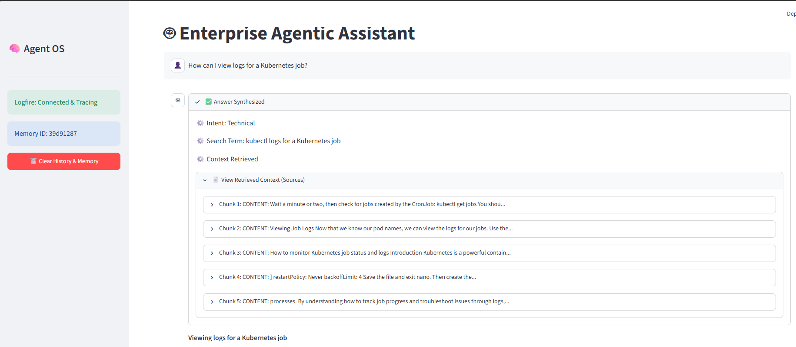
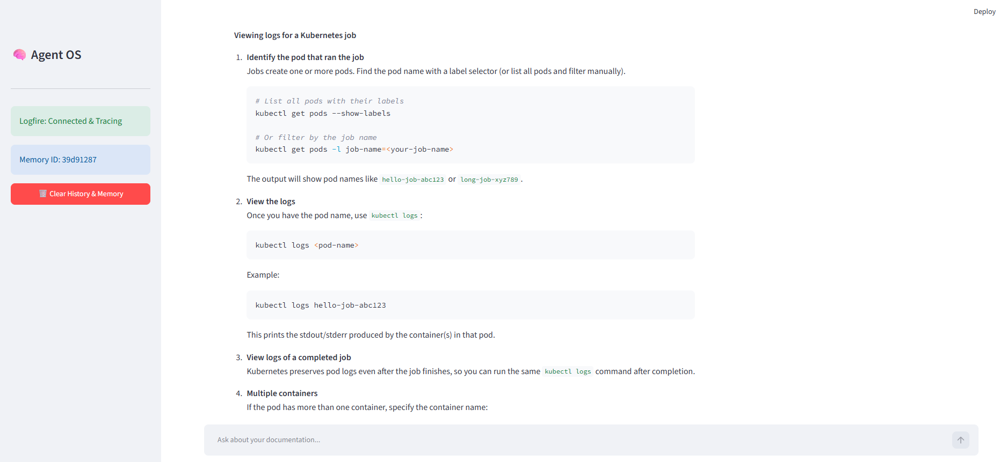
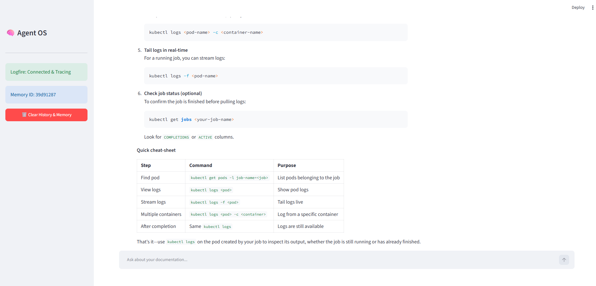
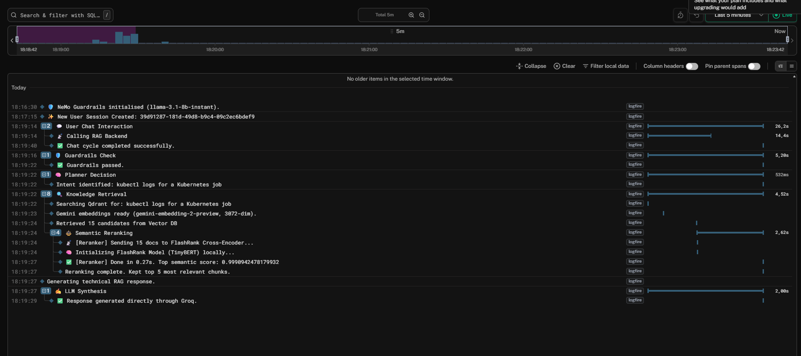
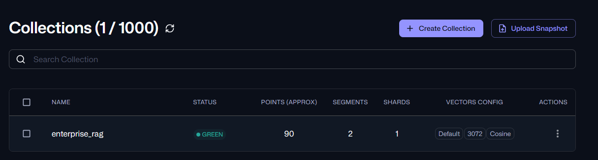
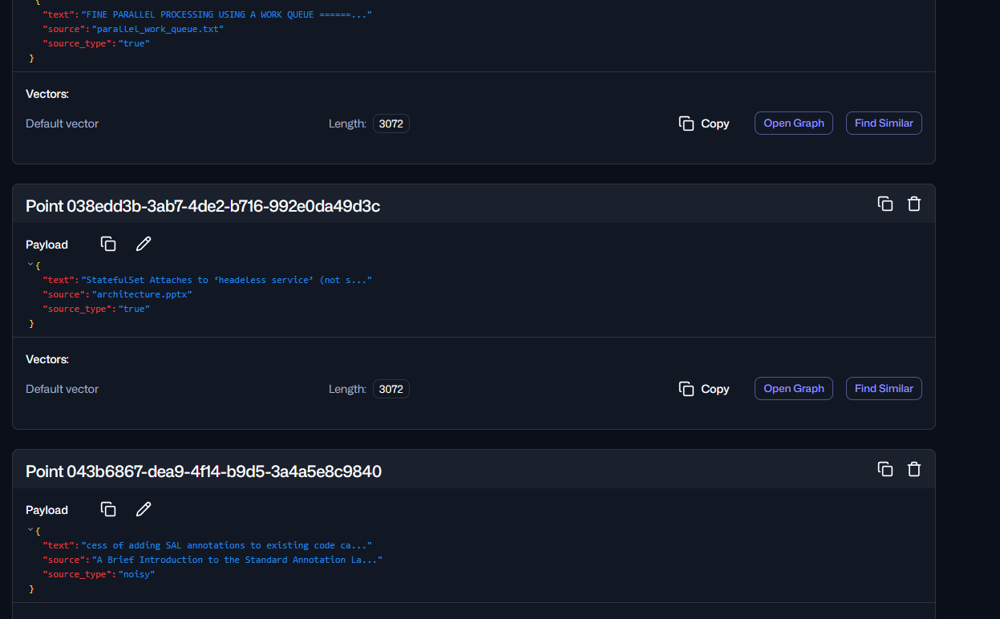

# Enterprise Agentic RAG

A locally running document question-answering application built with **FastAPI, LangGraph, NeMo Guardrails, Gemini embeddings, Qdrant, FlashRank, and Groq**. The system prepares technical documents for semantic search, routes questions through an agent workflow, and generates answers from retrieved context.

The current implementation uses Groq directly with the configured `openai/gpt-oss-20b` model identifier. Portkey is not part of the active request path, and LangSmith tracing is disabled. Pydantic Logfire is used for execution traces and debugging.

## Features

- Parses PDF, HTML, TXT, DOCX, and PPTX files locally.
- Splits extracted text into chunks bounded by 1,500 characters.
- Creates Gemini embeddings and stores vectors and metadata in Qdrant Cloud.
- Labels documents with `source_type`, such as `true` and `noisy`.
- Uses NeMo Guardrails for configured greetings, capabilities, off-topic, and jailbreak flows.
- Uses a planner to distinguish conversational questions from technical search requests.
- Retrieves up to 15 candidate chunks and reranks the best 5 with FlashRank.
- Generates answers through Groq and exposes the workflow through FastAPI.
- Records processing steps, timings, and errors with Logfire.

“True” and “noisy” are relevance categories used for this experiment; they are not factual-truth labels.

## Workflow



Document preparation follows: **parse files → split text → create embeddings → store chunks in Qdrant**.

Question answering follows: **guard request → plan → retrieve → rerank → generate answer**.

## Demonstrated result

The local application successfully answered:

> How can I view logs for a Kubernetes job?

The response showed a technical intent, a refined search query, five retrieved context chunks, and `Response generated.` The initial true-data collection contained 70 points; after adding a 20-chunk noisy sample, Qdrant showed 90 points.

### Streamlit interface







### Logfire trace



The trace shows guardrails passing, planner decision, Qdrant retrieval, 15 candidates, FlashRank reranking to 5 chunks, and Groq response generation.

### Qdrant collection



The collection is GREEN, uses 3,072-dimensional cosine vectors, and contains approximately 90 points.



The payload view shows the stored text, source filename, vector length, and `source_type` values for both true and noisy documents.

## Repository layout

```text
app/
  agents/                  # LangGraph graph, state, planner, retriever, responder
  guardrails/              # NeMo initialization and Colang rules
  ingestion/               # Loaders, chunking, and indexing
  services/retrieval/      # Embeddings, Qdrant search, and reranking
  config.py                # Environment configuration
  main.py                  # FastAPI entrypoint
ui/app.py                  # Local Streamlit interface
screenshots/               # Demonstration images
check_duplicates.py        # Duplicate preview/cleanup utility
requirements.txt           # Dependencies
.env.example               # Blank configuration template
```

## Run locally on Windows

```bat
python -m venv .venv
.venv\Scripts\activate.bat
python -m pip install -r requirements.txt
copy .env.example .env
```

Fill in the Gemini, Groq, Qdrant, and Logfire values in `.env`. Never commit `.env`.

### Ingest documents

Place permitted documents in `DATA/true_data/` and run:

```bat
python -m app.ingestion.processor DATA/true_data true
```

For a small unrelated sample:

```bat
python -m app.ingestion.processor DATA/noisy_small noisy
```

Both categories are stored in the same Qdrant collection and distinguished by `source_type`. Ingestion sends chunks to Gemini for embeddings, so do not rerun it unnecessarily. Do not use `--wipe` during routine use.

### Start the backend

```bat
python -m uvicorn app.main:app --port 8000
```

Open <http://127.0.0.1:8000/docs>, expand **POST /query**, and submit:

```json
{
  "q": "How can I view logs for a Kubernetes job?",
  "thread_id": "demo_1"
}
```

### Start the local UI

In a second terminal with the virtual environment active:

```bat
python -m streamlit run ui/app.py
```

The UI calls the local backend at `BACKEND_URL`, defaulting to `http://localhost:8000`.


## Limitations

- This is a locally demonstrated implementation, not a deployed production service.
- One successful technical query does not establish benchmark-level retrieval accuracy.
- Guardrails cover configured flows and cannot guarantee detection of every unsafe request.
- Changed documents need a version-aware update strategy.
- Retrieved sources currently expose chunk text rather than page-level citations.
- Scale, persistent memory, and comprehensive evaluation require additional testing.

